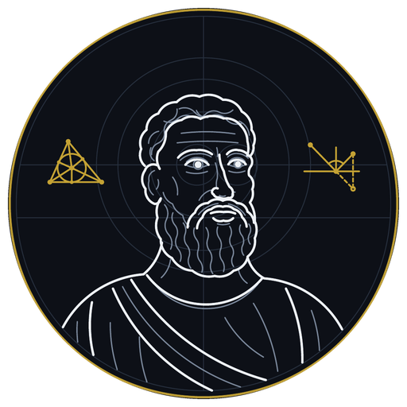

<a href="https://geometor.github.io/heron/"></a>

# GEOMETOR • heron

**Visit the Online Archive:** https://geometor.github.io/heron/

<p align="center">
  <a href="https://geometor.github.io/heron/"></a>
</p>

**Heron of Alexandria • Metrica, Definitiones, Catoptrica, Dioptra • semantic digital archive**

## Mission

`geometor/heron` is part of the interconnected [GEOMETOR](https://geometor.com) semantic digital archive. It liberates Heron of Alexandria's foundational works—*Metrica*, *Definitiones*, *Catoptrica*, and *Dioptra*—from isolated print bounds into addressable semantic units, synchronized bilingual reading tracks, calibrated theme-adaptive vector diagrams, primary-source folio provenance, and exact symbolic algebra across the GEOMETOR corpus.

## Books in This Archive

- [Metrica](https://geometor.github.io/heron/metrica/) — Books I, II & III (ed. Hermann Schöne, 1903) establishing synthetic triangle area proofs, Archimedean volume quadratures, and exact division algorithms.
- [Definitions](https://geometor.github.io/heron/definitiones/) — Ὅροι τῶν γεωμετρίας ὀνομάτων (ed. Friedrich Hultsch, 1864 / J. L. Heiberg, 1912) formulating 133 genetic definitions and the universal gnomon.
- [Catoptrics](https://geometor.github.io/heron/catoptrica/) — Κατοπτρικά / De speculis (ed. Wilhelm Schmidt, 1900) presenting the foundational shortest-path variational proof for the law of reflection.
- [On the Dioptra](https://geometor.github.io/heron/dioptra/) — Περὶ διόπτρας (ed. Hermann Schöne, 1903) describing optical instrumentation, stellar alignment, and two-portal mountain tunneling.

## Repository Contents

- `docsrc/` — Four-track Book Codex, apparatus registries, and Sphinx docs compiled by [PHOTON publish](https://github.com/photon-platform/publish).
- `resources/` — Primary folio scans, structure maps, persons/citations registries, and review manifests.
- `src/geometor/heron/` — Exact symbolic geometry models, algebraic audits, and demonstration pipelines.

## Local Build & Verification

```bash
publish build
uv run --no-sync pytest
```
## Part of the GEOMETOR Knowledge Archive

Explore all **74 Book Codices** and **11 Mathematical Catalogs** at https://geometor.com/books/.
