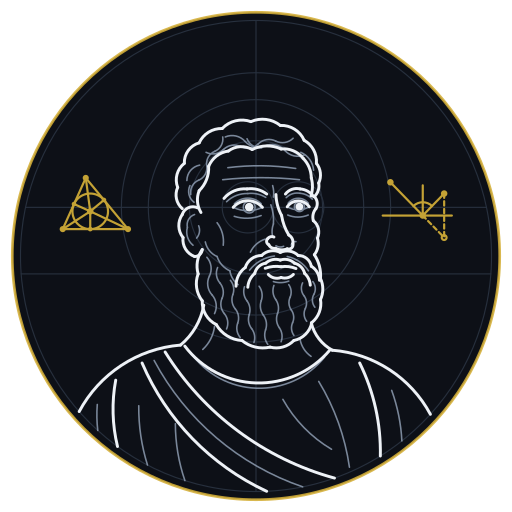

:site_title: Heron of Alexandria
:layout: book

.. _heron-home:

.. container:: author-overline

   semantic digital archive • the works of

===================
Heron of Alexandria
===================

:person:`Heron of Alexandria <hero>` (fl. c. 60 CE) bridged classical Euclidean rigor with practical mensuration, geodesy, and mathematical physics. This archive brings together his four foundational treatises—*Metrica*, *Definitions*, *Catoptrics*, and *On the Dioptra*—in synchronized English and Greek tracks paired with calibrated vector diagrams and exact symbolic demonstrations.

Works in This Archive
---------------------

.. container:: home-book-hero

   .. container:: home-book-thumb

      .. image:: _static/figures/heron-i8-incircle.svg
         :alt: Incircle construction for Heron's triangle area formula (Metrica I.8)
         :target: metrica/index.html

   .. container:: home-book-body

      .. rubric:: Schöne Edition · 1903 · 3 Books · 82 Propositions

      **Metrica (*Μετρικά*)** — Heron's three-book masterwork on the measurement of plane figures, stereometric surfaces and volumes (including Dionysodorus's torus), and exact proportional area division—featuring his incircle proof of the triangle area formula and iterative square-root approximations.

      .. container:: home-actions

         * :doc:`Open the Metrica → <metrica/index>`
         * :doc:`Book I (Plane Area) → <metrica/book_01/index>`
         * :doc:`Heron's Formula (I.8) → <metrica/book_01/prop_08/index>`

.. container:: home-book-hero

   .. container:: home-book-thumb

      .. image:: _static/figures/heronian-golden-gnomon.svg
         :alt: The Heronian golden gnomon and similarity invariant
         :target: definitiones/index.html

   .. container:: home-book-body

      .. rubric:: Hultsch 1864 & Heiberg 1912 · 133 Definitions · Universal Gnomon

      **Definitions (*Ὅροι τῶν γεωμετρίας ὀνομάτων*)** — A philosophical primer enriching Euclid's static boundaries with kinematic generation, rigid-motion symmetry, and the *Universal Gnomon* linking arithmetic sequences, squares, and golden-ratio scaling.

      .. container:: home-actions

         * :doc:`Open Definitions → <definitiones/index>`
         * :doc:`Browse 133 Definitions → <definitiones/definitions/index>`
         * :doc:`The Universal Gnomon → <definitiones/gnomon/index>`

.. container:: home-book-hero

   .. container:: home-book-thumb

      .. image:: _static/figures/catoptrica-reflection.svg
         :alt: Shortest-path proof of the Law of Reflection (Catoptrica Prop. 4)
         :target: catoptrica/index.html

   .. container:: home-book-body

      .. rubric:: Schmidt Edition · 1900 · Variational Optics

      **Catoptrics (*Κατοπτρικά / De speculis*)** — Formulates the earliest variational principle in mathematical physics, deducing the law of equal reflection angles from the postulate that nature acts along the shortest path.

      .. container:: home-actions

         * :doc:`Open Catoptrics → <catoptrica/index>`
         * :doc:`Reflection Law (Prop. 4) → <catoptrica/prop_04/index>`
         * :doc:`Symbolic Proof Demo → <demos/catoptrica-reflection>`

.. container:: home-book-hero

   .. container:: home-book-thumb

      .. image:: _static/figures/dioptra-mountain-tunnel.svg
         :alt: Orthogonal coordinate traverse for two-portal mountain tunneling (Dioptra Ch. 15)
         :target: dioptra/index.html

   .. container:: home-book-body

      .. rubric:: Schöne Edition · 1903 · Geodesy & Instrumentation

      **On the Dioptra (*Περὶ διόπτρας*)** — Describes the ancient precision sighting instrument and its application to surveying, astronomical alignment, and excavating a straight tunnel simultaneously from opposite sides of a mountain.

      .. container:: home-actions

         * :doc:`Open On the Dioptra → <dioptra/index>`
         * :doc:`Mountain Tunnel (Ch. 15) → <dioptra/cap_15/index>`
         * :doc:`Geodetic Demo → <demos/golden-gnomon-dioptra>`

Key Features
------------

.. container:: home-feature-grid

   .. container:: home-feature-card

      **Four-Track Bilingual Codex**

      Read every treatise with synchronized **English**, critical **Greek** (Schöne, Hultsch, Heiberg, Schmidt), **Summary**, and primary-source **Notes** tracks linked directly to archival folios.

   .. container:: home-feature-card

      **Exact Symbolic Constructions**

      Explore 100% exact SymPy and ``geometor.model`` derivations of Heron's formula, :math:`\sqrt{720}` convergents, shortest-path reflection, Book III area division, and dioptra surveying in :doc:`Symbolic Demos <demos/index>`.

   .. container:: home-feature-card

      **7 Calibrated Vector Plates**

      Interactive SVG constructions connect proof labels, rational-trigonometry invariants, and geometric loci across the *Metrica*, *Definitions*, *Catoptrics*, and *Dioptra*.

Reference & Project
-------------------

.. container:: home-columns

   .. container:: home-col

      .. rubric:: Scholarly Apparatus

      * :doc:`People <people/index>` — Heron, Archimedes, Dionysodorus, Olympiodorus, Moerbeke, Schöne, Hultsch, Heiberg, and Schmidt
      * :doc:`Concordance <concordance>` & :doc:`Bibliography <bibliography>` — Folio-to-proposition concordance and critical sources
      * :doc:`Glossary <glossary>` — Key Greek mensuration, optical, and geodetic terms

   .. container:: home-col

      .. rubric:: About This Project

      * :doc:`About <about/index>` — Scope, sources, and editorial methodology
      * :doc:`Using This Edition <usage/index>` — Reading guide, track switching, and diagram controls
      * :doc:`Symbolic Demos <demos/index>` & :doc:`Changelog <changelog>` — Executable Python demonstrations and release notes

.. toctree::
   :maxdepth: 2
   :hidden:

   metrica/index
   definitiones/index
   catoptrica/index
   dioptra/index
   demos/index
   concordance
   bibliography
   people/index
   glossary
   about/index
   usage/index
   changelog
